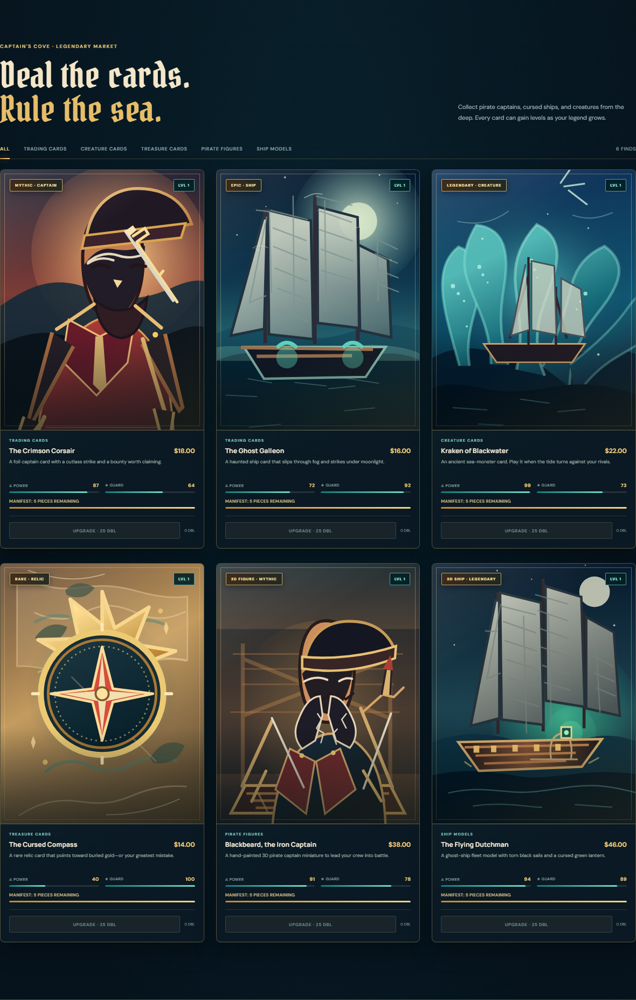
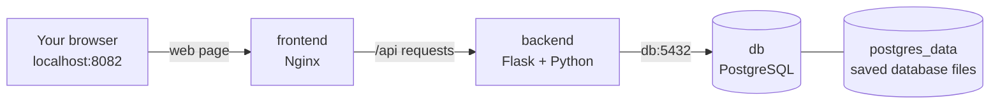

<p align="center">
  
</p>

<p align="center">
  
</p>

<h1 align="center">Saleor: Sea of Legends</h1>

<p align="center">
  An interactive pirate collectibles shop in a ship-filled Caribbean harbor.<br />
  A Docker-first learning project with trading cards, pirate figures, and ships.
</p>

> **About this project:** This is an independent learning demo branded with the Saleor name. It is not the official Saleor commerce platform. This guide centers on the Docker setup. You can build, run, and understand the containers without knowing how the shop's application code works.

## What you can do

- Explore the harbor through clickable map pins, then browse six trading cards, pirate figures, and ship models.
- Search and filter the collection, or spin the compass to jump to a random in-stock collectible.
- Add collectibles to the treasure chest, change quantities, and place a demo order.
- Earn 25 doubloons per collectible in a completed demo order, then spend them to level a card up to level 10. Levels and doubloons are saved in that browser.
- Track stock in each card's manifest. Each product starts with five pieces, and sold-out items stay visible.

## Start the shop

### What you need

- Docker Desktop on Windows or Mac, or Docker Engine and the Docker Compose plugin on Linux.
- An internet connection for the first image downloads and the remote display font.

You do **not** need to install Python, Node.js, or PostgreSQL on your computer. Docker runs those services in containers.

### 1. Open the project folder

Clone this repository and move into the folder that contains `compose.yaml`:

```sh
git clone https://github.com/Abdelrahmandaghash/Saleor-Sea-of-Legends.git
cd Saleor-Sea-of-Legends
```

If you already downloaded the project, open a terminal in the folder that contains `compose.yaml`.

### 2. Make sure Docker is running

```sh
docker --version
docker compose version
```

Both commands should print a version. Start Docker Desktop if either command says it cannot connect to Docker.

### 3. Build and launch the shop

```sh
docker compose up --build -d
```

The first launch downloads the base images, installs the API's Python packages, builds the two app images, creates the network and database volume, then starts the three services. It can take a few minutes. `-d` leaves them running in the background.

### 4. Check the services and visit the shop

```sh
docker compose ps
```

The database and API should become **healthy**. Then open:

- **Shop:** <http://localhost:8082>
- **API health check:** <http://localhost:5001/health>
- **Product list:** <http://localhost:5001/api/products>

To follow startup logs, run `docker compose logs -f`. Press `Ctrl+C` to stop watching logs; the services keep running.

## How the Docker setup works

Think of the setup this way: Dockerfiles are build recipes, images are the packaged result, and containers are the running services made from those images. Docker Compose reads `compose.yaml` and brings the related containers up together.



The browser sees the frontend. Nginx sends API requests to the backend over Docker's private network. The backend connects to PostgreSQL using the Compose service name `db`. PostgreSQL's files live in a named volume, so they survive when a database container is replaced.

### How I put Docker around the shop

1. I identified the three pieces that need to run together: the website, its API, and its database. They already existed as application code; Docker packages and connects them.
2. I used the Python Dockerfile to package the API and its pinned dependencies. I used the Nginx Dockerfile to package the static website.
3. I used the official PostgreSQL image for the database instead of writing a third Dockerfile.
4. I added the three services to `compose.yaml`, gave the API its database address, and published the website and API ports for local use.
5. I gave PostgreSQL a named volume so its data survives normal container removal, and added health checks so the API and website wait for services they need to be ready.
6. I start the complete stack with `docker compose up --build -d` and use Compose logs and status to see what is running.

### What each Docker file does

| File | What it does |
| --- | --- |
| [`compose.yaml`](compose.yaml) | Describes the three services, how to build or get their images, their settings, network ports, health checks, startup order, restart behavior, and saved database volume. |
| [`backend/Dockerfile`](backend/Dockerfile) | Recipe for the Flask API image: start with Python, install the listed packages, copy in the API, and run it. |
| [`backend/requirements.txt`](backend/requirements.txt) | Names and pins Flask and the PostgreSQL driver that the API image installs. |
| [`backend/.dockerignore`](backend/.dockerignore) | Keeps local Python caches, virtual environments, and `.env` files out of the backend image build context. |
| [`frontend/Dockerfile`](frontend/Dockerfile) | Recipe for the website image: start with Nginx, copy in the static site and its Nginx settings, and run Nginx. |
| [`frontend/nginx.conf`](frontend/nginx.conf) | Tells Nginx to serve the web page and forward `/api/` requests to the backend service. |
| [`frontend/.dockerignore`](frontend/.dockerignore) | Keeps Git metadata, logs, and local Node packages out of the frontend image build context. |
| `frontend/images/` | Holds the harbor scene and six original pirate collectible illustrations. They are local SVG files copied into the Nginx image and served as website assets. |
| `docs/screenshots/` | Contains fresh screenshots of the harbor landing page, full storefront, and card market. |
| [`frontend/index.html`](frontend/index.html), [`frontend/styles.css`](frontend/styles.css), [`frontend/app.js`](frontend/app.js) | Describe the harbor page, its visual design, card market interactions, shopping chest, and browser-saved level upgrades. |
| [`backend/app.py`](backend/app.py) | Seeds the pirate cards and collectibles, exposes the API, checks stock, and records demo orders in PostgreSQL. |
| [`.gitignore`](.gitignore) | Tells Git to ignore local secrets, Python caches, and other machine-specific files. It does not configure Docker. |

### `compose.yaml`, explained

The top-level `services:` section defines three containers. Compose automatically puts them on a private network together, which lets them find one another by service name.

| Compose setting | What it means here |
| --- | --- |
| `db.image: postgres:16-alpine` | Use the official PostgreSQL 16 image with a small Alpine Linux base. There is no custom database Dockerfile. |
| `environment` | Pass configuration into a container when it starts. `POSTGRES_DB` and `POSTGRES_USER` create the local database and user. `POSTGRES_PASSWORD` uses `local-saleor-demo` unless you provide a different `POSTGRES_PASSWORD` environment variable. In `${POSTGRES_PASSWORD:-local-saleor-demo}`, `:-` means “use this fallback if the variable is unset or empty.” |
| `db.volumes` | Attach the named `postgres_data` volume at PostgreSQL's data directory, `/var/lib/postgresql/data`. This is what preserves the database files. |
| `healthcheck.test` | Run `pg_isready` inside the database container to see whether PostgreSQL accepts connections. `$${...}` is escaped so the variable is expanded inside the container, not early by Compose. |
| `healthcheck.interval`, `timeout`, `retries` | Check every five seconds, allow each check five seconds, and try up to twelve times before marking the database unhealthy. |
| `backend.build.context: ./backend` | Build the API image using the `backend` folder as its build context. The Dockerfile and files it copies must be available in that folder. |
| `backend.environment.DATABASE_URL` | Give Flask the database connection address. The hostname `db` is the Compose service name, and `5432` is PostgreSQL's internal container port. The password uses the same Compose variable/default as the database. |
| `ports: "${BACKEND_HOST_PORT:-5001}:5000"` | Publish backend container port `5000` on your computer. Host port `5001` is the default; set `BACKEND_HOST_PORT` in `.env` to choose another free host port. |
| `depends_on` with `condition: service_healthy` | Wait for the database health check before starting the backend; wait for the backend health check before starting the frontend. This waits for readiness, not just for a container process to exist. |
| `backend.healthcheck.test` | Ask the API's `/health` URL from inside its container. It succeeds only when the API can respond and reach the database. |
| Backend health timing | Wait 15 seconds before the first API check, then check every 10 seconds, allow 5 seconds per check, and retry up to five times. |
| `frontend.build.context: ./frontend` | Build the website image from the `frontend` folder using its Dockerfile. |
| `ports: "${FRONTEND_HOST_PORT:-8082}:80"` | Publish Nginx's container port `80` as port `8082` on your computer. That is why the shop is at `localhost:8082`; set `FRONTEND_HOST_PORT` in `.env` to choose another free host port. |
| `restart: unless-stopped` | Restart a service if it stops unexpectedly, unless you explicitly stopped it. This applies to all three services. |
| Top-level `volumes: postgres_data:` | Ask Docker to create and manage a named volume for PostgreSQL. Compose supplies the volume; the database image writes the actual data into it. |

PostgreSQL has **no `ports` mapping**, so it is not directly published to your computer. The API reaches it through the private Compose network. The frontend and backend mappings are written as `computer-port:container-port`; the left side can be changed with the host-port variables above.

### What is inside each Dockerfile?

**`backend/Dockerfile`**

```dockerfile
FROM python:3.12-slim
WORKDIR /app
COPY requirements.txt .
RUN pip install --no-cache-dir -r requirements.txt
COPY app.py .
EXPOSE 5000
CMD ["python", "app.py"]
```

- `FROM` chooses a starting image: Python 3.12 on a smaller Debian base.
- `WORKDIR` makes `/app` the working folder for the remaining build steps and the start command.
- The first `COPY` puts the dependency list in the image.
- `RUN` installs the pinned packages while building the image. `--no-cache-dir` avoids saving an extra package download cache in the image.
- The second `COPY` puts the Flask API file in `/app`.
- `EXPOSE` documents that the API listens on container port `5000`; Compose's `ports` setting is what publishes it on your computer.
- `CMD` is the default process when a container starts: run `python app.py`. The JSON array form passes arguments directly to Python.

**`frontend/Dockerfile`**

```dockerfile
FROM nginx:1.27-alpine
COPY . /usr/share/nginx/html/
COPY nginx.conf /etc/nginx/conf.d/default.conf
EXPOSE 80
CMD ["nginx", "-g", "daemon off;"]
```

- `FROM` starts from the official Nginx web-server image.
- The first `COPY` puts the HTML, CSS, JavaScript, and logo in Nginx's website folder. Files matched by `.dockerignore` are left out.
- The second `COPY` installs this project's Nginx configuration.
- `EXPOSE 80` documents Nginx's container port.
- `CMD` runs Nginx in the foreground (`daemon off;`). A container stays running while its main process stays running.

The `frontend/nginx.conf` file tells that web server what to do:

- `listen 80` accepts traffic on Nginx's container port 80; Compose maps that to your computer's port 8082 by default.
- `server_name localhost` gives this local site a server name.
- `location /api/` matches API URLs. `proxy_pass http://backend:5000` forwards them to the Compose service named `backend`; Docker's private DNS resolves that name to the right container.
- The `proxy_set_header` lines pass the original host, client address, and protocol along with the API request.
- `location /` handles normal website files. `root` selects Nginx's HTML folder, `index` chooses the default page, and `try_files` serves a requested file if it exists or falls back to `index.html`.

### The `.dockerignore` files

Docker sends the build context folder to the image builder. A `.dockerignore` file leaves out files that the image does not need:

- **Backend:** `__pycache__/`, `*.pyc`, `*.pyo`, and `*.pyd` are Python cache/compiled files; `.venv/` is a local Python environment; `.env` may contain local settings; `.git/` and `.gitignore` are Git metadata/settings; `.DS_Store` is a macOS folder-view file.
- **Frontend:** `node_modules/` is a local JavaScript dependency folder; `.git/` and `.gitignore` are Git files; `*.log` matches log files. This frontend uses plain HTML, CSS, and JavaScript, so it does not need Node to run.

## Docker commands I use

Run these in the folder containing `compose.yaml`:

| Command | What it does |
| --- | --- |
| `docker compose up --build -d` | Build/rebuild the app images if needed, create the network and volume, start the services, and return to the prompt while they run. |
| `docker compose ps` | Show the Compose containers and their current/health status. |
| `docker compose logs -f` | Follow live output from all services. `-f` means keep following; `Ctrl+C` exits log viewing without stopping the services. |
| `docker compose logs -f backend` | Follow only the backend logs. Add `--tail=100` to first show up to 100 recent lines. |
| `docker compose down` | Stop and remove the containers and private network. It keeps the named database volume. |
| `docker compose up -d` | Start the existing stack again without explicitly rebuilding images. |
| `docker compose exec db psql -U saleor -d saleor` | Open PostgreSQL's command-line client inside the running database container, using the `saleor` user and database. Type `\q` to leave. |
| `docker compose down -v` | Stop and remove the containers, network, **and named volume**. This permanently erases saved orders, carts, and stock levels. Use only when you want a full reset. |

After changing the site or Docker files, use `docker compose up --build -d` so the changed files are copied into rebuilt images. Normal restarts and rebuilds keep the database volume. To intentionally start from a new empty demo database, run `docker compose down -v` and then `docker compose up --build -d`.

## Useful details and limits

- The API creates its database tables and inserts the six catalog items on startup. New products start with five pieces; existing stock is not reset on a normal restart.
- The database password defaults to `local-saleor-demo` for local learning. It can be overridden with a `POSTGRES_PASSWORD` environment variable, but this setup is not a production secrets system.
- Card levels and doubloons are saved in browser storage, separate from the PostgreSQL inventory and orders. Clearing browser data resets the collection upgrades.
- The harbor and collectible illustrations are local SVG files stored with the frontend. The display font is loaded from Google Fonts; the HTML, styling, API, and database run locally in Docker.
- Checkout is only a demo: no payment is processed and no parcel is shipped. This project also has no production authentication, TLS, backups, or deployment pipeline.

If a service does not start, check `docker compose ps` and `docker compose logs --tail=100`. If the shop loads without images or fonts, check the internet connection. If port `8082` or `5001` is already in use, set `FRONTEND_HOST_PORT` or `BACKEND_HOST_PORT` in `.env` to a free port.
